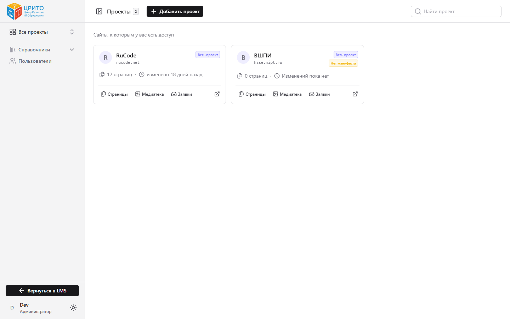
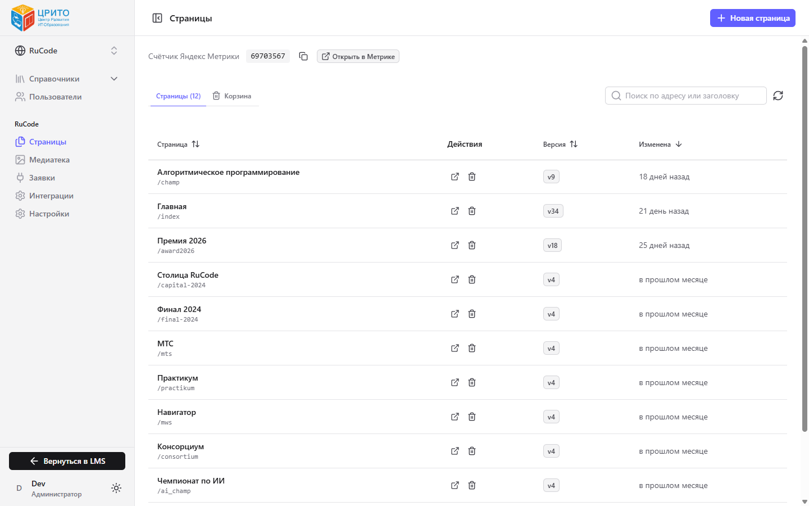
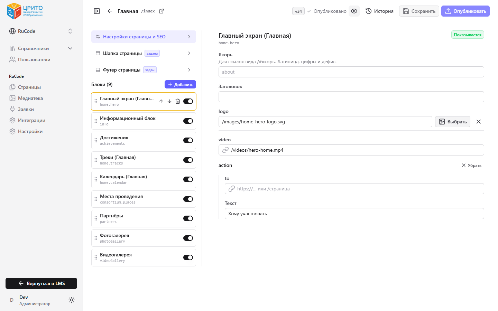

# CMS Panel

Headless CMS для управления сайтами, собранными из готовых блоков. Редактор меняет страницы в админке, а сайт получает опубликованное содержимое через API.

[Быстрый старт](#быстрый-старт) · [Подключение сайта](#подключение-сайта) · [Документация API](http://localhost:3000/docs) · [Развёртывание](deploy/README.md)



## О проекте

CMS Panel объединяет несколько сайтов в одной админке. У каждого проекта свои страницы, медиатека и манифест доступных блоков. Первым подключён сайт [RuCode](https://github.com/tanzihaosin/rucode); CMS также подготовлена для других проектов.

Разработчик описывает компоненты и их схемы на стороне сайта. По манифесту CMS строит каталог блоков и формы редактирования, а API проверяет содержимое перед сохранением. Сохранённый черновик не виден посетителям до публикации.

## Возможности

- Создание страниц из блоков, изменение их порядка и видимости, настройка шапки, футера и SEO.
- Черновики, публикация, история версий и откат; защита от конфликтов при одновременном редактировании.
- Предпросмотр страницы и выбранного блока на подключённом сайте, если сайт поддерживает интеграцию.
- Медиатека с поиском и защитой от удаления файлов, используемых страницами; корзина страниц с восстановлением.
- Доступ ко всему проекту или отдельным страницам, пользователи и административные права.
- Заявки с форм сайта, общий справочник регионов и Telegram-уведомления о заявках.
- Публичный API контента, проверка данных по схемам манифеста и вебхук сброса кэша сайта.

## Скриншоты

**Страницы проекта RuCode**



**Редактор главной страницы RuCode**



## Технологии

Монорепозиторий на npm workspaces: API на NestJS 12, Prisma 7 и PostgreSQL, админка на Nuxt 4, Vue 3, Nuxt UI и Tailwind CSS 4. Общий TypeScript-контракт связывает API, админку и сайты. Для редактирования форматированного текста используется Tiptap; тесты написаны на Vitest.

## Быстрый старт

Понадобятся Git, Node.js 22 или новее с npm и Docker с Compose. Если PostgreSQL уже установлен, можно использовать его, указав адрес в `DATABASE_URL`.

```bash
git clone https://github.com/tanzihaosin/cms-panel.git
cd cms-panel
npm ci
cp apps/api/.env.example apps/api/.env
npm run db:up
npm run db:migrate
```

В PowerShell вместо `cp` можно использовать `Copy-Item apps/api/.env.example apps/api/.env`. В файле `apps/api/.env` установите `AUTH_DEV_BYPASS=true`, чтобы локально работать от имени администратора без входа. Этот режим доступен только при `NODE_ENV=development` и не предназначен для боевого сервера.

Запустите API и админку в двух терминалах, сначала API:

```bash
npm run api    # http://localhost:3000
npm run admin  # http://localhost:3100
```

Откройте <http://localhost:3100>. Swagger UI доступен в режиме разработки на <http://localhost:3000/docs>. Для остановки серверов нажмите `Ctrl+C`; базу можно остановить командой `npm run db:down`.

По умолчанию Compose публикует PostgreSQL на порту `5432`, а пример конфигурации использует базу, пользователя и пароль `crito`. Если порт уже занят другой базой, измените опубликованный порт в локальном Compose override и укажите тот же порт в `DATABASE_URL`. Ошибка `P1000` может означать, что API подключается к другому серверу PostgreSQL.

## Как посмотреть проект

Чистая база не содержит проектов и страниц. Создайте проект кнопкой «Добавить проект» и сохраните показанный один раз ключ CI. Для создания и редактирования страниц сайт должен передать в проект манифест блоков. Существующий контент RuCode можно перенести отдельно: порядок экспорта, загрузки манифеста и импорта описан в [справочнике](docs/reference.md#миграция-контента-rucode).

В проекте откройте «Страницы», выберите страницу и блок. Кнопка «Сохранить» записывает общий черновик; только «Опубликовать» обновляет страницу для посетителей. Предпросмотр зависит от настроенного адреса сайта и поддержки предпросмотра на его стороне.

Локальный обход входа удобен для разработки. Для входа по почте и паролю без обхода создайте первого суперадминистратора через CLI, как описано в [справочнике](docs/reference.md#быстрый-старт-локальный-запуск). Интеграция входа через LMS зависит от настройки доверенных заголовков и nginx.

## Подключение сайта

Сайт получает опубликованные страницы из API проекта; для RuCode адрес задаётся через `NUXT_CMS_BASE_URL`, например `http://localhost:3000/public/rucode`. Главная страница хранится под slug `/index`. Основные страницы RuCode используют локальные данные, если CMS недоступна или ответ некорректен; страницы, существующие только в CMS, требуют её доступности.

Манифест с типами и схемами блоков собирается в репозитории сайта и загружается в CMS с ключом CI. Для предпросмотра и сброса кэша нужно настроить адрес сайта, вебхук и секрет. Подробности интеграции и формат обмена приведены в [справочнике CMS](docs/reference.md#подключение-сайта) и [README RuCode](https://github.com/tanzihaosin/rucode#интеграция-с-cms-crito).

## Конфигурация и развёртывание

Пример переменных API находится в [`apps/api/.env.example`](apps/api/.env.example). Обязательна `DATABASE_URL`; `PUBLIC_BASE_URL` определяет адреса файлов, сохраняемые в содержимом страниц. Для боевого режима нужны собственные `SESSION_SECRET` и `SECRETS_KEY`: последний необходим для чтения зашифрованных секретов из базы. Медиафайлы хранятся на диске отдельно от PostgreSQL, поэтому для полного восстановления нужны и резервная копия базы, и каталог файлов, и ключ шифрования.

Админка обращается к API через серверный прокси; его адрес задаётся `NUXT_API_URL`. Переменные, права, Telegram, резервное копирование и меры безопасности описаны в [справочнике](docs/reference.md#конфигурация). Инструкция для развёртывания с pm2 и nginx находится в [`deploy/README.md`](deploy/README.md).

## Проверки

```bash
npm test            # Тесты API и админки
npm run typecheck   # Проверка типов контракта, API и админки
npm run test:e2e    # Интеграционные тесты API с PostgreSQL
npm run build       # Сборка API и админки
```

Для e2e нужна запущенная PostgreSQL: тесты создают и удаляют отдельную базу `crito_e2e`, не рабочую базу проекта. Адрес административного подключения можно переопределить через `E2E_ADMIN_DATABASE_URL`.

## Структура

```text
apps/api/          API, схема Prisma и миграции
apps/admin/        админка и серверный прокси API
packages/contract/ общие типы API, админки и сайтов
scripts/rucode/    экспорт и импорт исходного контента RuCode
deploy/            конфигурация и инструкции для развёртывания
docs/              скриншоты и подробный справочник
```
